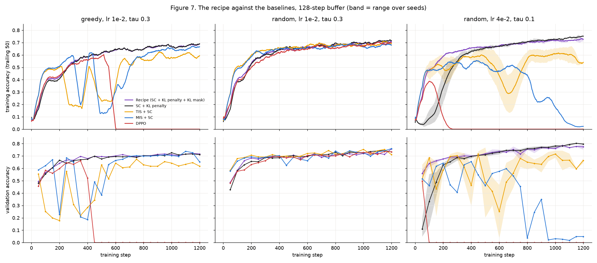
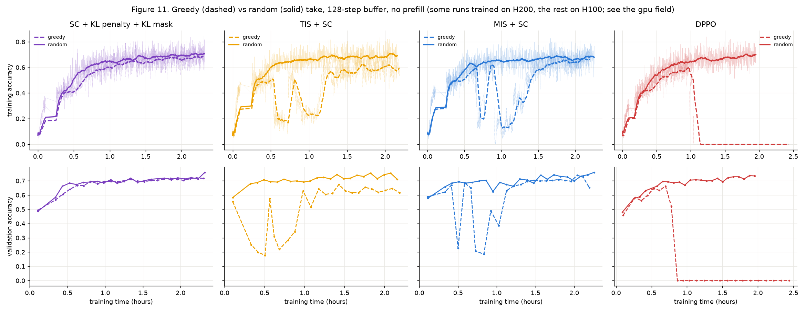

# Async-RL-Science

Code, data and plotting scripts for the blog post
**[Beyond Score Centering: What Else Can We Optimize in Async RL?](https://sky-posttrain.github.io/score-centering-async-rl/)**
(Qiuyang Mang and Yichuan Wang).

In async RL the trainer learns from trajectories sampled by older policies. Score
centering (SC; [Marek & Ryabinin](https://arxiv.org/abs/2609.20807)) removes the drift
term that makes old trajectories dominate the update. The post studies what to add on
top of SC and how the rollout buffer should be read:

- a **state-level KL mask**, which drops positions where `KL(mu(.|s) || pi(.|s))`
  exceeds a threshold, in place of token-ratio masks (TIS / MIS);
- an **age-scheduled KL penalty** `beta_a = beta_0 / sqrt(a)`, and the recipe that
  combines the two;
- **random sampling from the buffer** instead of oldest-first (greedy / FIFO), which
  lowers the mean batch age from 127 to about 52 for 4-7% more FLOPs.

Everything runs on Countdown with Qwen3-0.6B, with 64 prompts x 8 completions per step
and plain SGD.

## Quick start: redraw the figures

The per-step data of every run in the post is in [`repro/data`](repro/data). Redrawing
the figures needs only numpy and matplotlib:

```bash
pip install numpy matplotlib
python repro/plot_blog.py        # -> repro/figures/
```

`plot_blog.py` prints the numbers quoted in the post next to the ones it recomputes.


*The recipe (SC + KL penalty + KL mask) against TIS + SC, MIS + SC and DPPO, 128-step buffer: greedy take at lr 1e-2, random take at lr 1e-2, random take at lr 4e-2 (Figure 7 of the post).*


*Greedy (oldest-first) vs random take from the same 128-step buffer, against training time (Figure 11).*

## Re-running the experiments

[`repro/README.md`](repro/README.md) lists every run behind each figure, the launcher,
and the gradient-by-age pipeline. In short:

```bash
# environment: see torchtitan/experiments/rl/README.md (PyTorch nightly, vLLM, Monarch, TorchStore)
python scripts/download_hf_assets.py --repo_id Qwen/Qwen3-0.6B --all \
    --local_dir torchtitan/experiments/rl/example_checkpoint
bash repro/run.sh async128randnp sc_klreg_kl03      # one 8-GPU host, ~2.2 h on H100
python repro/export_runs.py && python repro/compare_reruns.py --rerun outputs/rerun_export
```

## Where things are

| path | content |
|---|---|
| `torchtitan/experiments/rl/` | the async RL loop: vLLM samplers and a torchtitan trainer on separate GPUs, orchestrated with [Monarch](https://github.com/meta-pytorch/monarch), with weights synced through [TorchStore](https://github.com/meta-pytorch/torchstore) |
| `torchtitan/experiments/rl/controller.py`, `components/work_buffer.py` | the rollout buffer: age cap `K` (`max_offpolicy_steps`), take order (`sample_order` = `fifo` / `random` / `lifo`), prefill, sampler sync interval |
| `torchtitan/experiments/rl/losses/is_grid.py` | all objectives in the post: PG, TIS, MIS, DPPO and the rest of the SC paper's Table 1, score centering, KL penalty, KL mask (`NAMED_METHODS`) |
| `torchtitan/experiments/rl/examples/countdown/` | the Countdown environment, reward and every run configuration (`config_registry.py`) |
| `repro/` | launcher, export, gradient-by-age measurement, figure scripts, released data |

## Relation to torchtitan

This repository is a trimmed fork of [pytorch/torchtitan](https://github.com/pytorch/torchtitan).
It keeps the core library and the RL experiment, and drops the other experiments and
examples. The upstream documentation in [`docs/`](docs) still applies to the core.
The BSD 3-Clause license is in [`LICENSE`](LICENSE).

## Citation

```bibtex
@misc{mang2026beyondsc,
  title  = {Beyond Score Centering: What Else Can We Optimize in Async RL?},
  author = {Mang, Qiuyang and Wang, Yichuan},
  year   = {2026},
  url    = {https://sky-posttrain.github.io/score-centering-async-rl/}
}
```

The Countdown setup follows the score-centering paper and its
[reference implementation](https://github.com/martin-marek/score-centering).
