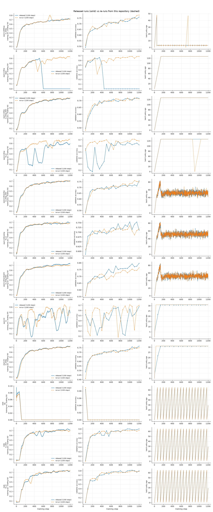

# Reproducing the blog post

This directory reproduces every data figure of
[Beyond Score Centering: What Else Can We Optimize in Async RL?](https://sky-posttrain.github.io/score-centering-async-rl/)
on Countdown with Qwen3-0.6B.

| file | what it does |
|---|---|
| `run.sh` | launches one training run (`<variant> <method>`) on one 8-GPU host |
| `export_runs.py` | turns the runs' TensorBoard events into per-step JSONL files (`data/runs/`) |
| `grad_by_age.py` | the offline gradient-by-age measurement behind Figures 1, 2 and 4 (`data/grad_by_age/`) |
| `compare_reruns.py` | overlays your re-runs on the released runs (training accuracy, validation, batch age) |
| `plot_blog.py` | draws the figures from `data/` into `figures/` and prints the numbers the post quotes next to the recomputed ones |
| `data/runs/` | per-step exports of the runs used in the post (one `<variant>__<method>.jsonl.gz` per run, plus `summary.csv`) |
| `data/grad_by_age/` | per-trajectory gradient norms used in the post (`grads_T{200,400,600}.jsonl`) |
| `figures/` | the figures `plot_blog.py` draws from the released data |

## 1. Redraw the figures from the released data (CPU only, about a minute)

```bash
pip install numpy matplotlib
python repro/plot_blog.py            # all figures -> repro/figures/
python repro/plot_blog.py --fig 7 8  # a subset
```

## 2. Re-run the experiments

Install the environment as described in
[`torchtitan/experiments/rl/README.md`](../torchtitan/experiments/rl/README.md)
(PyTorch nightly, vLLM, Monarch, TorchStore). Then download the model weights to the
path the configs read:

```bash
python scripts/download_hf_assets.py --repo_id Qwen/Qwen3-0.6B --all \
    --local_dir torchtitan/experiments/rl/example_checkpoint
```

One run on one 8-GPU host (a 2-GPU trainer and 6 single-GPU vLLM samplers, the layout
used for every run in the post):

```bash
bash repro/run.sh <variant> <method>
bash repro/run.sh async128randnp sc_klreg_kl03     # the recipe, random take, lr 1e-2
```

A 1,200-step run takes about 2.2 hours on H100s (the 2,400-step `async128s*` runs
about twice that). Outputs go to `outputs/countdown/<variant>/<method>/`. When the runs
are done:

```bash
python repro/export_runs.py --runs outputs/countdown --out outputs/rerun_export
python repro/compare_reruns.py --rerun outputs/rerun_export     # against the released runs
python repro/plot_blog.py --data outputs/rerun_export           # the figures from your runs
```

Metrics are written to TensorBoard event files in the run folder (what `export_runs.py`
reads) and to W&B, which `run.sh` keeps offline unless you set `WANDB_MODE=online`.
`run.sh` passes any extra arguments to the trainer, e.g.
`--async_loop.num_training_steps 10` for a quick check. With fewer GPUs, set
`NUM_GENERATORS` and `TRAINER_GPUS` (and `RL_GPUS=0,1,...` to pick devices). Fewer
samplers slow generation relative to training, so the async variants then see
younger data than in the post. Check `age_mean` in the export.

Every run starts from the same checkpoint. Seed 0, the default, leaves vLLM sampling
unseeded, so a re-run follows the same trend as the post but not the same per-step
values.

### Runs behind each figure

Configs are `rl_countdown_qwen3_0_6b_<variant>_<method>`
(`torchtitan/experiments/rl/examples/countdown/config_registry.py`). All runs use lr
1e-2 unless the variant says `lr4` (4e-2), 64 prompts x 8 completions per step, plain
SGD, 1,200 steps, and one seed unless listed.

| figure | variant(s) | methods |
|---|---|---|
| 1, 2, 4 | `stale` (checkpoints of one `tis_sc` run, see below) | measured offline for `pg sc tis tis_sc sc_kl1 sc_kl03 sc_kl01` |
| 5 left | `stale` | `sc_klreg sc_kl03 tis_sc sc pg tis` |
| 5 right | `async32` | `sc_klreg sc_kl03 tis_sc sc pg tis` |
| 6 | `async128s1 async128s2 async128s3` (2,400 steps) | `sc_kl03 tis_sc mis_sc` |
| 7, 8 col 1 | `async128np` | `sc_klreg_kl03` (recipe), `sc_klreg tis_sc mis_sc dppo` |
| 7, 8 col 2 | `async128randnp` | `sc_klreg_kl03` (recipe), `sc_klreg tis_sc mis_sc dppo` |
| 7, 8 col 3 | `async128randnplr4 async128randnplr4s1 async128randnplr4s2` | `sc_klreg_kl01` (recipe), `sc_klreg` (3 seeds); `tis_sc` (seeds 0 and 2); `mis_sc dppo` (seed 0) |
| 10 | `stale async128np async128lifonp async128randnp` | `sc_klreg` |
| 11 | `async128np async128randnp` | `sc_klreg_kl03` (SC + KL penalty + KL mask), `tis_sc mis_sc dppo` |

Method names (`torchtitan/experiments/rl/losses/is_grid.py`, `NAMED_METHODS`):

| name | in the post | definition |
|---|---|---|
| `pg` | PG | REINFORCE on the sampler's trajectories, no correction |
| `tis` | TIS | token weight `min(p/q, 2)` |
| `sc` | SC | score centering: subtract the sampler-expected score (top-128 head from the sampler, tail `rho * p`) |
| `tis_sc` / `mis_sc` | TIS + SC / MIS + SC | SC plus a token weight `min(p/q, 2)` / `1[0.5 <= p/q <= 5]` |
| `dppo` | DPPO | PPO-style sign-aware clip on a per-token TV band of 0.2 |
| `sc_kl1` `sc_kl03` `sc_kl01` | SC + KL mask tau | SC, dropping positions with head `KL(mu(.|s) \|\| pi(.|s)) > tau` (1.0 / 0.3 / 0.1) |
| `sc_klreg` | SC + KL penalty | SC minus `beta_a KL(mu \|\| pi)` per token, `beta_a = 0.3 / sqrt(a)` (0 at age 0) |
| `sc_klreg_kl03` / `sc_klreg_kl01` | recipe, tau 0.3 / 0.1 | SC + KL penalty, both terms masked at positions with head KL above tau |

Variants:

| variant | setting |
|---|---|
| `stale` | samplers get new weights every 65 steps: batch age is a 0..64 sawtooth (the SC paper's "staleness 64") |
| `async32` | weights pushed every step, 32-step buffer, oldest-first take: batch age ~31 |
| `async128np` | 128-step buffer, no prefill, oldest-first ("greedy"/FIFO): age climbs to 127 |
| `async128randnp` | same buffer, uniform random take: mean age ~52, max ~128 |
| `async128lifonp` | same buffer, newest-first take: age ~3 after the initial backlog |
| `async128s{1,2,3}` | 128-step buffer prefilled with 127 steps of groups, oldest-first, 2,400 steps, seeds 1-3: age 127 throughout |
| `async128randnplr4[s1,s2]` | `async128randnp` at lr 4e-2, seeds 0-2 |

### Gradient by policy age (Figures 1, 2, 4)

These figures come from offline measurements on the checkpoints of one staleness-64
TIS + SC run:

```bash
bash repro/run.sh stale tis_sc --async_loop.num_training_steps 600 \
    --trainer.checkpoint.interval 8 --trainer.checkpoint.keep_latest_k 0
python repro/grad_by_age.py convert                 # checkpoints -> HF weights
for i in 0 1 2 3; do python repro/grad_by_age.py sample $i $i 4 & done; wait
for t in 200 400 600; do python repro/grad_by_age.py grads 0 $t; done
python repro/plot_blog.py --fig 1 2 4 --grads outputs/grad_by_age
```

For steps T = 200, 400 and 600, the checkpoints of ages 0, 8, ..., 64 each sample 8
completions for the same 64 prompts. Every trajectory's loss under each method is then
differentiated at theta_T. The loss is divided by the batch's completion tokens, with
no clipping, and the L2 norm of the parameter gradient is recorded.

## Verification: re-runs from this repository

We re-ran twelve runs from the post with this repository as published (`repro/run.sh`,
same layout: a 2-GPU trainer and 6 vLLM samplers on one 8-GPU H100 host) and compared
them with the released data using `compare_reruns.py`:



| run | figure | training acc., last 50 steps (released / re-run) | validation, mean of last 3 evals (released / re-run) | mean batch age (released / re-run) |
|---|---|---|---|---|
| `async128np sc_klreg_kl03` | 7, 8 col 1 (recipe, greedy) | 0.688 / 0.692 | 0.717 / 0.716 | 119.8 / 119.8 |
| `async128np tis_sc` | 7, 8 col 1 | 0.593 / 0.677 | 0.632 / 0.694 | 119.8 / 119.8 |
| `async128np dppo` | 7, 8 col 1 | collapsed at step ~550 / 0.625 | collapsed / 0.671 | 119.5 / 119.4 |
| `async128randnp sc_klreg_kl03` | 7, 8 col 2 (recipe, random) | 0.707 / 0.701 | 0.731 / 0.753 | 51.0 / 51.0 |
| `async128randnp tis_sc` | 7, 8 col 2 | 0.691 / 0.691 | 0.736 / 0.704 | 51.0 / 51.0 |
| `async128randnplr4 sc_klreg_kl01` | 7, 8 col 3 (recipe, random, lr 4e-2) | 0.736 / 0.703 | 0.781 / 0.751 | 51.0 / 51.0 |
| `async128lifonp sc_klreg` | 10 | 0.716 / 0.724 | 0.753 / 0.766 | 3.9 / 4.9 |
| `async32 sc_klreg` | 5 right | 0.720 / 0.714 | 0.753 / 0.749 | 29.6 / 30.6 |
| `async32 sc` | 5 right | 0.486 / 0.611 | 0.595 / 0.529 | 29.6 / 30.6 |
| `stale sc_kl03` | 5 left | 0.716 / 0.703 | 0.789 / 0.765 | 32.5 / 32.5 |
| `stale tis_sc` | 5 left | 0.734 / 0.737 | 0.790 / 0.786 | 32.5 / 32.5 |
| `stale pg` | 5 left | collapsed / collapsed | collapsed / collapsed | 32.5 / 32.5 |

The stable methods (the recipe, SC + KL penalty, SC + KL mask, TIS + SC under staleness 64)
reproduce closely: the batch-age schedules match, and the accuracy curves agree to within
the run-to-run noise of unseeded sampling (validation uses 64 problems, so one evaluation
moves by a few points between runs). For scale, the three released seeds of the lr 4e-2
recipe end at 0.736, 0.733 and 0.712 training accuracy; the re-run's 0.703 sits just below
that range.

The unstable methods reproduce their instability, not their exact trajectory. Plain PG
collapses in both runs. SC alone under `async32` and TIS + SC and DPPO under the greedy
128-step buffer go through repeated drops and recoveries in both the released runs and the
re-runs, at different steps, so their last-50 numbers differ by up to 0.13. In particular,
the released greedy DPPO run collapsed for good at step ~550, while the re-run dipped
several times but recovered each time within 1,200 steps. A single seed does not settle
whether such a run collapses: the released data has three seeds of DPPO with the
buffer prefilled to age 127 (`async128s{1,2,3}__dppo`), and two of them collapse while the
third ends at 0.668. Under the greedy buffer the re-run recipe (0.692) still ends above the
re-run TIS + SC (0.677) and DPPO (0.625), as in Figure 7.

In `async32` the released runs' batch age climbs to 31 over the first ~140 steps, while
the re-runs' buffer fills within ~30 steps; after that both stay at 31. The released
`async32` runs predate a fix to how samplers claim work from the buffer; before it,
generation ran only slightly faster than training, so the buffer filled slowly.
The
`async128np tis_sc` re-run is missing 50 logged steps from a restart (its export has
1,150 of the 1,200 steps).

## The released data

`data/runs` also holds a few runs beyond the table above (for example `mis_sc`, `dppo`,
`sc_kl01` and `sc_kl1` under `stale` and `async32`, and `pg` under the 128-step buffers).

The runs trained on H100 or H200 hosts (`gpu` field, `summary.csv`). This matters only for
wall-clock comparisons such as Figure 11: in the greedy/random pairs there, `tis_sc` ran on H200
on both sides, `sc_klreg_kl03` on H100 on both sides, while `mis_sc` and `dppo` are split.

The post quotes 0.735 for the recipe at lr 4e-2 (Figure 8, third column); that is the mean over
seeds 0 and 1. With seed 2 included the mean is 0.727, which `plot_blog.py` reports.

Per-step export fields (`data/runs/*.jsonl.gz`, one JSON object per training step):

- `reward`: training accuracy of the batch.
- `val`: validation accuracy, every 50 steps (64 held-out problems x 8 samples).
- `kl_k1`: sampled-token KL between sampler and trainer.
- `age_mean`, `age_max`: batch policy age.
- `groups_dropped`, `buffer_groups`, `buffer_inflight`: buffer state.
- Token counts and cumulative generation and training FLOPs (`flops_cum`).
- Timing: `wall_s` (seconds since step 1, with resume gaps removed), `step_time_s`,
  `wait_batch_s`, and `gpu`.

The header of `export_runs.py` defines each field. `data/runs/summary.csv` gives one row
per run.

Every training run passes through one long validation at step 50, which shows as a gap
of about 8 minutes in `wall_s`. It costs the same in every run.

`data/grad_by_age/grads_T*.jsonl` holds one line per trajectory, with fields `T`, `age`,
`prompt`, `reward`, `adv` and `tokens`. Lines with nonzero advantage also carry the
gradient norm under each method (`pg sc tis tis_sc sc_kl01 sc_kl03 sc_kl1`), plus `drift`
= ||g_SC - g_PG|| and `drift_tis` = ||g_TIS+SC - g_TIS||. They also carry the KL-mask
masked fractions and the per-token sampler-trainer `kl_k1` and `head_tv`.
